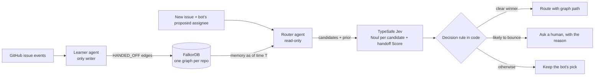

# Handoff Graph

**Issue routing that remembers who hands what to whom.**

Every time an issue is passed on ("not me, ask @y"), a *learner* agent records the handoff in a FalkorDB graph. A *router* agent reads that memory, asks a decision model (TypeSafe Jev) one narrow question per candidate, and then does one of three things: routes the issue, keeps the current owner, or asks a human. Every decision comes with the graph path that justifies it.

### The result

> **Without graph memory, the same AI has to hand about two-thirds of issues to a human. With it, about one in twenty. When it does route, it's about as accurate as Microsoft's dedicated triage classifier on the same issues (within 0.2 points), and it's within 2–4 points of that classifier on first-try accuracy. It needs no training and no per-repo model, and it shows the graph path for every decision.**

Measured on two held-out periods of real microsoft/vscode issues (summer n = 1,133; spring n = 3,064), each run once with a frozen design:

| The same AI decision model (TypeSafe Jev) and the same decision code | Has to ask a human | Right owner, first try |
|---|---|---|
| **Without graph memory** | 67% / 65% | 18% / 15% |
| **With FalkorDB graph memory** | **4% / 7%** | **74% / 59%** |
| *For scale: VS Code's dedicated triage classifier¹* | *0%* | *77% / 62%* |

<sub>Each cell shows summer / spring. ¹VS Code triages new issues with an automatic classification bot (`classifier-deep`). It has per-category confidence thresholds and a hand-maintained feature-area ownership file (`.github/classifier.json`), and team members fix its mistakes by hand ([VS Code wiki](https://github.com/Microsoft/vscode/wiki/Issue-Tracking)).</sub>

- **It does not beat Microsoft's classifier on a single first guess.**
  - On the issues our agent routes, both are right about equally often (summer 77.2% vs 77.4%; spring 62.6% vs 62.8%).
  - A pre-registered attempt to beat it (+2 points of precision) worked on development data and failed on unseen data.
  - Even perfect knowledge of which issues get forwarded would only reach about 85%. Handoffs depend on workload and absences that aren't visible when an issue arrives.
- **Handoff memory goes stale within weeks.** The memory's best alternative named the eventual owner of 38% of bounced issues in July–August, but only 13% a month later. Memory about people has to keep learning.

**Identified after the results** (descriptive; these metrics weren't pre-registered):
- **Top-3 suggestions:** the agent's top three contain the eventual owner 81% / 69% of the time, vs 77% / 62% for the classifier's single pick. That's useful when a human triager picks from suggestions.
- **Bounce-risk flag:** when the agent asks for a human, the classifier's pick is wrong 36% / 47% of the time, vs 23% / 38% overall.

**Try it in the browser:** https://handoff-graph.up.railway.app/ (live routing on real VS Code issues, the memory explorer, and the recorded replay).
**Live MCP server:** `https://handoff-graph.up.railway.app/mcp` (tools: `route_issue`, `handoff_history`, `record_handoff`; writes are disabled on the public server).

<sub>The live demo runs FalkorDB on Railway with a persistent volume, reachable only over Railway's private network. We moved off the FalkorDB Cloud Free tier because free instances stop after a day idle and wouldn't survive judging.</sub>

Built for [Graph Hacks: Context for AI Agents](https://www.wemakedevs.org/hackathons/falkordb) (WeMakeDevs × FalkorDB).
**Track: Agent Memory and Coordination** (also relevant to Agents That Act on Connected Data).

## The problem

- Reassigned incidents take up to 10× longer to triage at Microsoft (ICSE'19; DeepTriage, KDD'20).
- 37–44% of Mozilla and Eclipse bugs get tossed between developers (Jeong et al., FSE'09).
- Ticketing tools count reassignments, but none learns from *who handed what to whom*.

In **microsoft/vscode** (June to mid-October 2026):
- 11,734 issues were filed.
- 65% of first assignments came from the triage bot.
- 1,678 issues (16% of assigned issues) were handed off to someone else, and **79% of those started with the bot's pick**.

## Results

All numbers come from a time-ordered replay of real triage, where each issue is routed at the moment VS Code's bot first assigned it. Each held-out period was run **once** with a frozen design. Full tables, protocol and disclosures are in [docs/RESULTS.md](docs/RESULTS.md).

**Summer held-out period** (Aug 25 – Sep 15 2026, 1,133 issues, design v1)

| Arm | Right first time | Escalated | Precision when routed |
|---|---|---|---|
| VS Code triage bot (deployed) | 76.9% | 0% | 76.9% |
| Jev, no graph (same decision code) | 18.4% | 66% | 55.0% |
| Jev "keep it?" check, no graph | 33.2% | 62% | 86.4% |
| **Jev + graph memory** | 74.3% | **4%** | 77.2% |

**Spring held-out period** (Apr 1 – May 15 2026, 3,064 issues, fresh data and a separate graph, design v2)

| Arm | Right first time | Escalated | Precision when routed |
|---|---|---|---|
| VS Code triage bot (deployed) | 62.1% | 0% | 62.1% |
| Jev, no graph | 15.0% | 64.5% | 42.2% |
| Jev "keep it?" check, no graph | 28.2% | 58.1% | 67.3% |
| Graph only (v2, no Jev) | 55.6% | 12.9% | 63.8% |
| **Jev + graph memory (v2)** | 58.5% | **6.6%** | 62.6% |

- **Pre-registered win condition** for v2 (precision ≥ bot + 2 points at ≤ 15% escalation): **not met**.
- **Cost:** about one Jev call per issue, median latency about 0.4 s, and under $0.0001 per routed issue.
- **The deployed MCP server runs the v1 design** (the summer table).
- **Precision when routed, on the same issues:** the agent is right 77.2% vs the classifier's 77.4% (summer), and 62.6% vs 62.8% (spring). That's a tie. The small edge in the tables above comes from *which* issues get escalated, not from better routing.

**Why it can't beat the bot on first-try accuracy.** We checked the ceiling on development data. Even perfect knowledge of *which* issues get forwarded, sending each to the pick's most common recent handoff target, would reach about 85% vs the bot's 78%. That 7-point gap isn't visible in the issue at routing time. We tested four signals:
- issue text: AUC 0.57;
- the pick's recent forward rate: AUC 0.74, but no positive override rule;
- who filed it: the bot still wins;
- forwarding streaks.

Handoffs depend on workload, leave and conversations the router can't see. The median handoff happens about a day after routing.

**What memory sees that the bot doesn't.** When the bot's pick has forwarded their last three issues in a row, the bot's next pick for them was right only 3 times out of 12 (development data). They're usually away. The graph knows that; the bot keeps assigning to them. The case is rare (under 1% of issues), but it shows the kind of judgement memory makes possible.

## How it works



### Graph data model

| Element | Meaning |
|---|---|
| `(:Issue {number, title, body, created_at, routing_time})` | A GitHub issue |
| `(:Person {login, bot})` | An assignee |
| `(:Area {name})` | A product-area label (workflow labels such as `bug` are excluded) |
| `(:Issue)-[:HAS_LABEL {added_at, removed_at}]->(:Area)` | Timestamped, so the router only sees labels that existed at routing time |
| `(:Issue)-[:ASSIGNED {at, by, by_bot, removed_at}]->(:Person)` | Every assignment, with who made it |
| `(:Person)-[:HANDED_OFF {issue, at, kind, areas}]->(:Person)` | **The memory.** Written by the learner when A is unassigned and B takes over. `kind` is `forward`, `claim` or `reassign`. |

Each repository lives in its own FalkorDB graph (`hg:<owner>:<repo>`), so tenants never share memory.

### The two agents
- **Learner** (`learner.py`) is the only component that writes memory. It turns assignment events into `HANDED_OFF` edges. During a replay it advances one day at a time.
- **Router** (`router.py`, `agent.py`) is read-only. Every query takes a time `$t` and filters `at < $t`, so a decision can never see the future.

### The queries the product depends on

Who has the proposed assignee handed work to recently? This is the memory behind every routing path:
```cypher
MATCH (a:Person {login: $first_pick})-[h:HANDED_OFF]->(b:Person)
WHERE h.at < $t AND h.at >= $since AND h.kind IN ['forward', 'reassign']
WITH b, count(h) AS times, max(h.at) AS last_at, collect(h.issue)[0..5] AS examples
RETURN b.login AS login, times, last_at, examples
ORDER BY times DESC, last_at DESC LIMIT $k
```

What did that person keep, and what did they hand to each candidate? This is the contrastive evidence shown to Jev:
```cypher
MATCH (i:Issue)-[s:ASSIGNED]->(:Person {login: $a})
WHERE s.by_bot AND s.at < $t AND s.removed_at > $t AND i.number <> $number
RETURN i.title ORDER BY s.at DESC LIMIT $k
```
```cypher
MATCH (:Person {login: $a})-[h:HANDED_OFF]->(b:Person)
WHERE h.at < $t AND h.issue <> $number AND ($b = '' OR b.login = $b)
MATCH (i:Issue {number: h.issue})
RETURN i.title ORDER BY h.at DESC LIMIT $k
```

Which labels did the issue have at routing time?
```cypher
MATCH (i:Issue {number: $number})-[l:HAS_LABEL]->(a:Area)
WHERE l.added_at <= $t AND l.removed_at > $t
RETURN collect(a.name) AS areas
```

The model never writes Cypher. The MCP server exposes a fixed set of tools over these parameterised queries.

### The decision rule (fixed in code before results were looked at)
- **Prior from graph memory:** P(stays with A) = kept/received, and P(goes to B) = handed-to-B/received. In v2 these counts cover the last 60 days.
- **Likelihood from Jev, in one request:**
  - One `Noul` per candidate: "Is this issue the same kind of work as what this person kept, or what A handed to them?"
  - One `Score`: "Is this issue more like what A keeps, or what A hands off?"
- **Posterior** = prior × likelihood, normalised.
- **Tie-break:** a single `Choice` among the close candidates, with the option order shuffled because Jev favours the first option.
- **Outcome (v2):**
  - route to the alternative if it leads by at least 0.5;
  - otherwise ask a human if P(leaves A) is at or above the threshold tuned on TUNE;
  - otherwise keep the bot's pick.
- **Memory trust:** with fewer than 10 recorded forwards for A, keep the bot's pick.

## MCP tools

| Tool | What it does |
|---|---|
| `route_issue(title, body, proposed_assignee)` | Owner or escalation, the confidence margin, each candidate's probability, and the graph path |
| `handoff_history(person)` | Who this person hands work to, how often, with example issues |
| `record_handoff(issue, from, to)` | Teaches the graph a new "not me, ask @y" |

Use the hosted server from Claude Code:
```bash
claude mcp add --transport http handoff-graph https://handoff-graph.up.railway.app/mcp
```
Or run it locally: `claude mcp add handoff-graph -- uv --directory /path/to/handoff-graph run python -m handoff_graph.mcp_server`.

## Evaluation protocol

We replay real triage in time order: every issue is routed at the moment VS Code's bot first assigned it, and is scored against who still owned it at the end of the data.

- **Population:** issues whose first assignment came from VS Code's triage bot, so the deployed bot is a real baseline rather than a straw man.
- **No leakage:**
  - memory is learned day by day;
  - every query filters `at < T`;
  - labels added after T are invisible;
  - truth must have had 30 or more days to settle.
- **Periods:**
  - LEARN: Jun 1 – Jul 5
  - TUNE: Jul 6 – 19 (thresholds only)
  - DEV: Jul 20 – Aug 24 (all design work)
  - HOLDOUT: Aug 25 – Sep 15 (run once per frozen design)
- **Arms:**
  - the deployed bot;
  - the graph alone;
  - Jev without the graph, with the same decision code and a plain "recently active" candidate list;
  - Jev deciding only "keep it?" without the graph;
  - Jev with graph memory.
- **Disclosure:** two early designs were inspected before the DEV/HOLDOUT split was imposed. Details are in [docs/RESULTS.md](docs/RESULTS.md).

## Run it

**Without any setup:** `uv run python -m handoff_graph.demo results/replay_20261015T203103Z.json` replays the recorded held-out decisions.

**Reproduce the held-out tables without a Jev key:** fetch the public issue data (below), ingest it, then run the replay with `--offline`. It uses the committed Jev answer cache in `data/cache/jev.jsonl`.


```bash
docker run -d --name hg-falkordb -p 6380:6379 -p 3001:3000 falkordb/falkordb:latest
cp .env.example .env   # add TYPESAFE_API_KEY
uv sync
# fetch the public issue data (uses your `gh` login; ~10 min)
python3 data/fetch_vscode_issues.py 2026-06-01 2026-10-15 data/raw/vscode_issues_2026-06-01_2026-10-15.json
python3 data/fetch_bodies.py data/raw/vscode_issues_2026-06-01_2026-10-15.json data/raw/vscode_bodies.json
uv run python -m handoff_graph.ingest data/raw/vscode_issues_2026-06-01_2026-10-15.json --bodies data/raw/vscode_bodies.json
uv run python -m handoff_graph.replay --arms bot,graph,jev_nograph,jev_keep,jev_graph
uv run python -m handoff_graph.learner data/raw/vscode_issues_2026-06-01_2026-10-15.json   # learn all handoffs
uv run python -m handoff_graph.mcp_server        # MCP over stdio (or --http 8765)
```

## Prior art

- Jeong, Kim & Zimmermann, *Improving Bug Triage with Bug Tossing Graphs* (FSE 2009)
- Microsoft DeepTriage (KDD 2020) and DeepCT (ASE 2019)
- Linear Triage Intelligence, Mozilla bugbug, ServiceNow Predictive Intelligence, and Prow's blunderbuss plugin

Handoff Graph differs from these in four ways:
- it learns handoffs online, as they happen;
- it gives every decision with an explainable graph path;
- it escalates when unsure, using a confidence gate;
- it is scored with a leakage-safe, time-ordered replay against the deployed bot.

## AI assistance disclosure

This project was built with Claude Code (Anthropic) as a coding assistant. The author reviewed the design, data model, evaluation protocol and results, and is responsible for them.

## Data and licences

- Issue metadata comes from the public GitHub API for microsoft/vscode (MIT-licensed repository).
- People are shown by GitHub handle only. Findings describe team routing patterns, not individuals.
- The decision model is TypeSafe Jev, pinned to `jev-1.14.0`.
