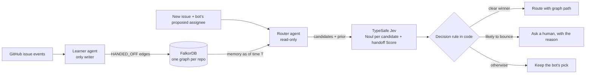

# Handoff Graph

**Issue routing that remembers who hands what to whom.** Every time an issue is passed on ("not me, ask @y"), Handoff Graph records it in a FalkorDB graph. A decision model (TypeSafe Jev) then routes new issues using that memory. Every decision comes with the graph path behind it, and when the evidence is weak it asks a human instead of guessing.

**What we measured** (one-time held-out replay on 1,133 real microsoft/vscode issues; see [docs/RESULTS.md](docs/RESULTS.md)):
- **Graph memory is what makes AI routing usable.** With it, Jev routes 96% of issues itself at 77% precision. Without it, Jev has to hand 62–66% of issues to a human, and is often wrong when it does route.
- **It does not beat VS Code's own triage bot** (74.3% vs 76.9% right first time), and it did not reduce bounces on held-out data.
- **Handoff patterns drift within weeks** (the memory's best alternative was right on 38% of bounces in July–August vs 13% in late August–September). That argues for routers that keep learning online.

Built for [Graph Hacks: Context for AI Agents](https://www.wemakedevs.org/hackathons/falkordb) (WeMakeDevs × FalkorDB).
Tracks: **Agents That Act on Connected Data** and **Agent Memory and Coordination**.

## The problem

- Reassigned incidents take up to 10× longer to triage at Microsoft (ICSE'19; DeepTriage, KDD'20).
- 37–44% of Mozilla and Eclipse bugs get tossed between developers (Jeong et al., FSE'09).
- Ticketing tools count reassignments, but none learns from *who handed what to whom*.

In **microsoft/vscode** (June to mid-October 2026):
- 11,734 issues were filed.
- 64% of first assignments came from the triage bot.
- 15% of assigned issues were handed off, and **72% of those handoffs followed the bot's pick**.

## Results

_Filled in from the one-time HOLDOUT run; see [docs/RESULTS.md](docs/RESULTS.md)._

## How it works



### Graph data model

| Element | Meaning |
|---|---|
| `(:Issue {number, title, body, created_at, routing_time})` | A GitHub issue |
| `(:Person {login, bot})` | An assignee |
| `(:Area {name})` | A product-area label (workflow labels such as `bug` are excluded) |
| `(:Issue)-[:HAS_LABEL {added_at, removed_at}]->(:Area)` | Timestamped, so the router only sees labels that existed at routing time |
| `(:Issue)-[:ASSIGNED {at, by, by_bot, removed_at}]->(:Person)` | Every assignment, with who made it |
| `(:Person)-[:HANDED_OFF {issue, at, kind, areas}]->(:Person)` | **The memory.** Written by the learner when A is unassigned and B takes over. `kind` is `forward`, `claim` or `reassign`. |

Each repository lives in its own FalkorDB graph (`hg:<owner>:<repo>`), so tenants never share memory.

### The two agents
- **Learner** (`learner.py`) is the only component that writes memory. It turns assignment events into `HANDED_OFF` edges. During a replay it advances one day at a time.
- **Router** (`router.py`, `agent.py`) is read-only. Every query takes a time `$t` and filters `at < $t`, so a decision can never see the future.

### The queries the product depends on

Who has the proposed assignee handed work to recently? This is the memory behind every routing path:
```cypher
MATCH (a:Person {login: $first_pick})-[h:HANDED_OFF]->(b:Person)
WHERE h.at < $t AND h.at >= $since AND h.kind IN ['forward', 'reassign']
WITH b, count(h) AS times, max(h.at) AS last_at, collect(h.issue)[0..5] AS examples
RETURN b.login AS login, times, last_at, examples
ORDER BY times DESC, last_at DESC LIMIT $k
```

What did that person keep, and what did they hand to each candidate? This is the contrastive evidence shown to Jev:
```cypher
MATCH (i:Issue)-[s:ASSIGNED]->(:Person {login: $a})
WHERE s.by_bot AND s.at < $t AND s.removed_at > $t AND i.number <> $number
RETURN i.title ORDER BY s.at DESC LIMIT $k
```
```cypher
MATCH (:Person {login: $a})-[h:HANDED_OFF]->(b:Person)
WHERE h.at < $t AND h.issue <> $number AND ($b = '' OR b.login = $b)
MATCH (i:Issue {number: h.issue})
RETURN i.title ORDER BY h.at DESC LIMIT $k
```

Which labels did the issue have at routing time?
```cypher
MATCH (i:Issue {number: $number})-[l:HAS_LABEL]->(a:Area)
WHERE l.added_at <= $t AND l.removed_at > $t
RETURN collect(a.name) AS areas
```

The model never writes Cypher. The MCP server exposes a fixed set of tools over these parameterised queries.

### The decision rule (fixed in code before results were looked at)
- **Prior from graph memory:** P(stays with A) = kept/received, and P(goes to B) = handed-to-B/received. In v2 these counts cover the last 60 days.
- **Likelihood from Jev, in one request:**
  - One `Noul` per candidate: "Is this issue the same kind of work as what this person kept, or what A handed to them?"
  - One `Score`: "Is this issue more like what A keeps, or what A hands off?"
- **Posterior** = prior × likelihood, normalised.
- **Tie-break:** a single `Choice` among the close candidates, with the option order shuffled because Jev favours the first option.
- **Outcome (v2):**
  - route to the alternative if it leads by at least 0.5;
  - otherwise ask a human if P(leaves A) is at or above the threshold tuned on TUNE;
  - otherwise keep the bot's pick.
- **Memory trust:** with fewer than 10 recorded forwards for A, keep the bot's pick.

## MCP tools

| Tool | What it does |
|---|---|
| `route_issue(title, body, proposed_assignee)` | Owner or escalation, the confidence margin, each candidate's probability, and the graph path |
| `handoff_history(person)` | Who this person hands work to, how often, with example issues |
| `record_handoff(issue, from, to)` | Teaches the graph a new "not me, ask @y" |

Add it to Claude Code with `claude mcp add handoff-graph -- uv --directory /path/to/handoff-graph run python -m handoff_graph.mcp_server`.

## Evaluation protocol

We replay real triage in time order: every issue is routed at the moment VS Code's bot first assigned it, and is scored against who still owned it at the end of the data.

- **Population:** issues whose first assignment came from VS Code's triage bot, so the deployed bot is a real baseline rather than a straw man.
- **No leakage:**
  - memory is learned day by day;
  - every query filters `at < T`;
  - labels added after T are invisible;
  - truth must have had 30 or more days to settle.
- **Periods:**
  - LEARN: Jun 1 – Jul 5
  - TUNE: Jul 6 – 19 (thresholds only)
  - DEV: Jul 20 – Aug 24 (all design work)
  - HOLDOUT: Aug 25 – Sep 15 (run once per frozen design)
- **Arms:**
  - the deployed bot;
  - the graph alone;
  - Jev without the graph, with the same decision code and a plain "recently active" candidate list;
  - Jev deciding only "keep it?" without the graph;
  - Jev with graph memory.
- **Disclosure:** two early designs were inspected before the DEV/HOLDOUT split was imposed. Details are in [docs/RESULTS.md](docs/RESULTS.md).

## Run it

```bash
docker run -d --name hg-falkordb -p 6380:6379 -p 3001:3000 falkordb/falkordb:latest
cp .env.example .env   # add TYPESAFE_API_KEY
uv sync
uv run python -m handoff_graph.ingest data/raw/vscode_issues_2026-06-01_2026-10-15.json --bodies data/raw/vscode_bodies.json
uv run python -m handoff_graph.replay --arms bot,graph,jev_nograph,jev_keep,jev_graph
uv run python -m handoff_graph.mcp_server        # MCP over stdio
```

## Prior art

- Jeong, Kim & Zimmermann, *Improving Bug Triage with Bug Tossing Graphs* (FSE 2009)
- Microsoft DeepTriage (KDD 2020) and DeepCT (ASE 2019)
- Linear Triage Intelligence, Mozilla bugbug, ServiceNow Predictive Intelligence, and Prow's blunderbuss plugin

Handoff Graph differs from these in four ways:
- it learns handoffs online, as they happen;
- it gives every decision with an explainable graph path;
- it escalates when unsure, using a confidence gate;
- it is scored with a leakage-safe, time-ordered replay against the deployed bot.

## AI assistance disclosure

This project was built with Claude Code (Anthropic) as a coding assistant. The author reviewed the design, data model, evaluation protocol and results, and is responsible for them.

## Data and licences

- Issue metadata comes from the public GitHub API for microsoft/vscode (MIT-licensed repository).
- People are shown by GitHub handle only. Findings describe team routing patterns, not individuals.
- The decision model is TypeSafe Jev, pinned to `jev-1.14.0`.
