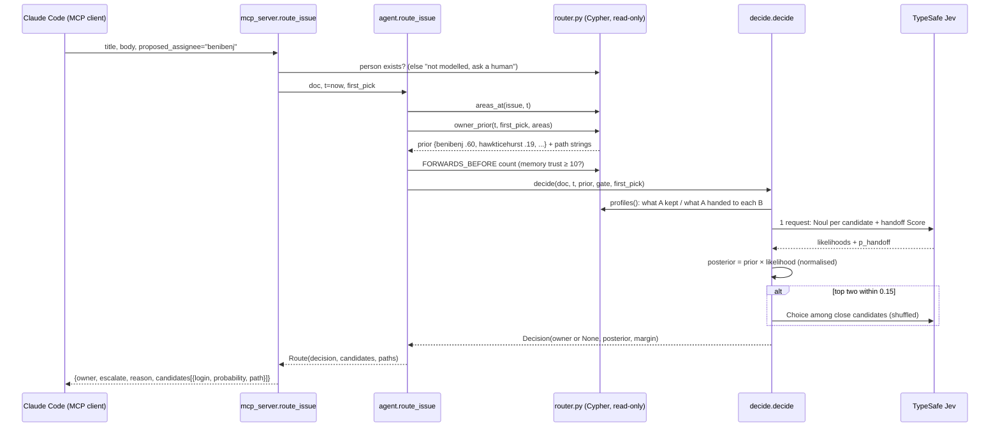

# How Handoff Graph works: execution and data flow

Written for a developer new to the codebase. Read it top to bottom once, then use the section headings to jump around.

---

## 1. The big picture in one diagram

```
                    ┌──────────────────────── OFFLINE (once) ────────────────────────┐
 GitHub API ──► data/fetch_vscode_issues.py ──► data/raw/*.json  (issues + timelines)
            └─► data/fetch_bodies.py ────────► data/raw/*bodies*.json
                                                   │
                                                   ▼
                                    ingest.py  (uses events.py to parse)
                                                   │  MERGE nodes/edges
                                                   ▼
                              ┌─────────────────────────────────────────┐
                              │  FalkorDB graph  "hg:microsoft:vscode"  │
                              │  Issue, Person, Area, ASSIGNED, HAS_LABEL│
                              │  + HANDED_OFF  (the memory)              │
                              └─────────────────────────────────────────┘
                                   ▲  writes                 │ reads (as of time T)
                                   │                         ▼
                    learner.py (LEARNER agent)      router.py + agent.py (ROUTER agent)
                                                             │ candidates + prior
                                                             ▼
                                                    decide.py ──► TypeSafe Jev API
                                                             │ posterior → decision
                                                             ▼
          ┌─────────── ONLINE ───────────┐        ┌──────── EVALUATION ────────┐
          │ mcp_server.py (MCP tools)    │        │ replay.py (time-ordered)    │
          │ ← Claude Code / any client   │        │ → results/*.json            │
          └──────────────────────────────┘        │ demo.py reads those results │
                                                  └─────────────────────────────┘
```

Three ways the code runs:
1. **Build the graph:** fetch, ingest, then the learner.
2. **Answer a live request:** the MCP server, then the agent, then the decision.
3. **Measure honestly:** the replay, then results files, then the demo player.

---

## 2. What each file does

| File | Role | Reads | Writes |
|---|---|---|---|
| `data/fetch_vscode_issues.py` | Downloads issues and their label/assignment timelines (GitHub GraphQL via `gh`) | GitHub | `data/raw/vscode_issues_*.json` |
| `data/fetch_bodies.py` | Downloads issue bodies (first 4,000 characters) | GitHub | `data/raw/*bodies*.json` |
| `events.py` | **Pure Python, no database.** Turns raw timelines into clean objects; finds handoffs | raw JSON | Python objects |
| `db.py` | Opens the FalkorDB connection (local or cloud); one graph per repo | `.env` | — |
| `ingest.py` | Writes issues, labels and assignments into the graph (idempotent `MERGE`) | raw JSON | graph |
| `learner.py` | **Learner agent.** The only writer of `HANDED_OFF` memory | handoffs | graph |
| `router.py` | **Router agent queries**, all read-only and all "as of time T" | graph | — |
| `decide.py` | Asks Jev, combines graph prior × Jev likelihood, decides | graph + Jev | — |
| `agent.py` | Glues router and decide together: `route_issue()` (v1) and `route_issue_v2()` | — | — |
| `mcp_server.py` | Exposes 3 tools over MCP (stdio or HTTP) | agent | graph (only `record_handoff`) |
| `replay.py` | Time-ordered evaluation with several arms and tuning; writes results | everything | `results/*.json` |
| `demo.py` | Replays **recorded** results for the video | `results/*.json` | screen |

---

## 3. The data model: what's in the graph

```
 (:Area {name})                       e.g. "workbench-tabs", "terminal"
      ▲
      │ HAS_LABEL {added_at, removed_at}      ← timestamped so we can ask "labels at time T"
      │
 (:Issue {number, title, body, created_at, routing_time})
      │
      │ ASSIGNED {at, by, by_bot, removed_at, removed_by}
      ▼
 (:Person {login, bot})
      │
      │ HANDED_OFF {issue, at, kind, areas}   ← THE MEMORY (written only by the learner)
      ▼
 (:Person)
```

- `removed_at = 9999999999` means "not removed yet". FalkorDB properties can't be null, so `ingest.OPEN` uses this sentinel.
- `kind` is one of:
  - `forward`: A passed the issue on themselves;
  - `claim`: B took it;
  - `reassign`: someone else moved it.

---

## 4. Flow 1: building the graph

### 4a. Parsing (`events.py`), the most important pure function

```
raw issue JSON ──► parse_issue(raw) ──► Issue
                      │
                      ├─ walks timeline events in time order:
                      │    LabeledEvent    → open a LabelInterval (area labels only; is_area_label())
                      │    UnlabeledEvent  → close it (removed_at)
                      │    AssignedEvent   → open an Assignment (who, at, by)
                      │    UnassignedEvent → close it (removed_at, removed_by)
                      └─ result: issue.labels[], issue.assignments[] (sorted by time)

Issue.areas_at(t)     → which area labels were on the issue at time t
Issue.routing_time    → first assignment time (when the bot routed it)
Issue.first_pick      → that first Assignment

derive_handoffs(issue) → [Handoff]
   rule: A was assigned, A was unassigned, and B was assigned at/after A's removal
         (120 s slack, because GitHub often records "assign B" just before "unassign A")
   kind: forward (B assigned BY A) | claim (BY B) | reassign (BY someone else)
   areas: issue.areas_at(handoff time)   ← never uses later labels

final_owners(issue)   → people still assigned at the end = the replay's ground truth
```

**Example timeline → objects:**
```
 01:00  bot assigns alice           Assignment(alice, at=01:00, by=bot)
 02:00  alice assigns bob           Assignment(bob,   at=02:00, by=alice)
 02:00:40 alice unassigns alice     alice.removed_at = 02:00:40
 ─────────────────────────────────
 derive_handoffs → Handoff(alice → bob, kind="forward", first_pick_by_bot=True)
 final_owners    → ("bob",)
```

### 4b. Ingestion (`ingest.py`)

```
main() ─► ingest(raw_issues, bodies, repo)
            ├─ get_graph(repo)                      db.py → FalkorDB connection, graph "hg:owner:repo"
            ├─ ensure_schema(g)                     CREATE INDEX on Issue.number, Person.login, ...
            ├─ parse_issue() for every issue        (events.py)
            ├─ build 3 row lists: issue_rows, label_rows, assign_rows
            └─ for each list, in batches of 500:
                  g.query(UPSERT_ISSUES | UPSERT_LABELS | UPSERT_ASSIGNMENTS, {"rows": batch})
                  (Cypher: UNWIND $rows AS r MERGE ... SET ...)
```
- **Idempotent:** `MERGE` matches existing nodes and edges by key, so running it twice gives the same graph. We verified this.
- `--body-chars 1500` trims bodies for the 100 MB free cloud tier.

### 4c. Learning (`learner.py`)

```
sync_from_raw(g, raw) ─► derive_handoffs() for every issue ─► record_handoffs(g, handoffs)
                                                                 └─ Cypher RECORD_HANDOFF:
                                                                    MATCH (a {login}), (b {login})
                                                                    MERGE (a)-[h:HANDED_OFF {issue, at}]->(b)
```
In the **replay**, the learner is called **one day at a time**, so memory grows the way it would have in real life.

---

## 5. Flow 2: a live request (MCP → decision)

### 5a. Sequence diagram



### 5b. The same flow as function calls, step by step

```
mcp_server.route_issue(title, body, proposed_assignee, repo)
 │
 ├─1 g = get_graph(repo)                                      db.py
 ├─2 _person_exists(g, proposed_assignee)  ── no ──► return {"escalate": True, "reason": "not modelled"}
 └─3 agent.route_issue(g, judge, doc, t=now, first_pick)
       │
       ├─ router.areas_at(g, number, t)                       labels at time t (new issue → [])
       ├─ router.owner_prior(g, t, first_pick, areas)
       │     ├─ BOT_ROUTED_TO       → how many issues the bot gave A before t   (= "received")
       │     ├─ LEARNED_FORWARDS    → who A handed to, how often, examples       (memory)
       │     ├─ AREA_OWNERS         → owners of those areas (small prior 0.02)
       │     └─ prior: P(A keeps) = (received − forwarded + 1)/(received + 2)
       │               P(B)       = forwards_to_B/(received + 2)     → normalise
       ├─ keep top 5 candidates, renormalise
       ├─ FORWARDS_BEFORE: if A has < 10 forwards → return "keep A" (memory not trusted)
       └─ decide.decide(g, judge, doc, t, prior, gate=0.5, first_pick=A)
             ├─ profiles(): A → titles A KEPT; B → titles A HANDED TO B (fallback: B's own issues)
             ├─ handoff_contrast(): (all kept titles, all handed-off titles) for A
             ├─ JevJudge.fit(): ONE Jev request
             │     questions = { "handoff": Score(kept vs handed off),
             │                   "fit_0..n": Noul("same kind of work as this person's list?") }
             │     returns likelihood{login: p}, tokens, p_handoff
             ├─ likelihood(A) *= (1 − p_handoff);  likelihood(B) *= p_handoff
             ├─ combine(prior, likelihood) → posterior (normalised)
             ├─ top_margin(posterior); if margin < 0.15 → JevJudge.tiebreak() (Choice, shuffled)
             └─ owner = top if margin ≥ gate else None ("ask a human")
```

> **Note:** the live MCP tool uses **v1** (`agent.route_issue`), the design measured on the summer holdout. `route_issue_v2` exists for the evaluation, and it scored about the same.

### 5c. A worked example with real numbers

Request: *"Tab titles render with no text in the new modern UI"*, proposed to `@benibenj`.

```
GRAPH MEMORY (before now)
  bot gave @benibenj 405 issues
     kept           238
     → hawkticehurst  75   (e.g. #325171, #325317)
     → mrleemurray    64
     → sandy081       11
     → hediet         10
PRIOR (from memory)     benibenj .60  hawkticehurst .19  mrleemurray .16  sandy081 .03  hediet .03
JEV (one request)       Score p_handoff + one Noul per candidate (fits the text?)
POSTERIOR               hawkticehurst .727   benibenj .202   hediet .041   sandy081 .023   mrleemurray .007
MARGIN                  .727 − .202 = .525 ≥ gate .5   →  ROUTE to @hawkticehurst
ANSWER                  owner + every candidate's probability + its graph path
```
If the margin had been below 0.5, the answer would have been **"ask a human,"** with the reason.

---

## 6. Flow 3: the replay, our honest measurement (`replay.py`)

### 6a. Time is the whole point

```
 Jun 1 ────────── Jul 6 ───── Jul 20 ─────────────── Aug 25 ──────── Sep 15 ──── Oct 15
 │    LEARN       │  TUNE     │        DEV           │   HOLDOUT     │ unsettled │
 │ memory only    │ thresholds│ all design work      │ run ONCE      │ not scored│
```
For each issue routed at time **T**:
- the learner has recorded only handoffs from **before T's day**;
- every query filters `at < T`;
- labels added after T are invisible.

### 6b. Function flow

```
replay.main()  (CLI: --arms, --holdout, --dataset, --limit, --offline)
 └─ run(arms, ...)
     ├─ g = get_graph(repo)
     ├─ load() → issues (parsed, sorted by routing_time), bodies
     ├─ population(): issues whose FIRST assignment was by the bot and that have a final owner
     ├─ handoffs = all derive_handoffs(), sorted by time
     ├─ judge = CachedJudge(JevJudge())        ← caches every Jev answer in data/cache/jev.jsonl
     ├─ learner.forget_all(g)                   ← start with empty memory
     ├─ for each day (in order):
     │     ├─ record_handoffs(g, handoffs that happened before this day)   ← learner advances
     │     └─ in 8 threads: route(g, judge, arm, issue, body) for every issue × arm
     │            arms:  bot          → the bot's recorded pick
     │                   graph        → top of owner_prior (no Jev)
     │                   jev_nograph  → decide() on "recently active people", uniform prior
     │                   jev_keep     → Jev only asks "should the bot's pick keep it?"
     │                   jev_graph    → agent.route_issue (v1)
     │                   graph_v2 / jev_graph_v2 → agent.route_issue_v2
     │            → Row(issue, period, pick, truth, margin, candidates, cost, ...)
     ├─ tune thresholds on TUNE rows only (pre-registered utility / ≤15% escalation)
     ├─ apply thresholds to all rows
     ├─ summarise() per arm: accuracy, escalated, precision when routed,
     │                       truth in candidates, bounced fixed, net hops, cost
     └─ write results/replay_<timestamp>.json  (summary + every row)
```

### 6c. Why `CachedJudge`?
- Each Jev answer is stored by a hash of the exact request. Re-running is free and gives identical numbers.
- That's how we proved the refactor into `agent.py` changed nothing: an offline re-run reproduced every holdout number exactly.

---

## 7. The key Python objects

```
Issue          number, title, created_at, labels[LabelInterval], assignments[Assignment]
LabelInterval  area, added_at, added_by, removed_at
Assignment     login, at, by, removed_at, removed_by
Handoff        issue, from_login, to_login, at, by, kind, first_pick_by_bot, areas
Candidate      login, score, reasons          (router.candidate_owners, the older ranking)
Decision       owner|None, posterior, margin, jev_calls, latency_ms, input_tokens, reason, noul, p_handoff
Route          decision, candidates, prior, paths, memory_trusted
Row            one replay result: issue, period, arm, pick, truth, margin, ... (saved to JSON)
```

---

## 8. Where the "graph doing real work" actually happens

1. **`LEARNED_FORWARDS`:** who A passes work to, recently, with example issues. This is the memory behind every path string.
2. **`KEPT_BY` / `HANDED_BY`:** the evidence shown to Jev, pulled from memory edges.
3. **Time filters (`at < $t`, `removed_at > $t`):** the same graph answers "what did we know at 10:42 on Aug 30?"
4. **One graph per repo:** separate memory per tenant, using FalkorDB's multigraph support.

Without these, Jev escalates about 60% of issues. With them, about 5%. That's the project's main result.

---

## 9. Commands, mapped to the flows

| Command | Flow |
|---|---|
| `python3 data/fetch_vscode_issues.py START END OUT` | Flow 1: fetch |
| `uv run python -m handoff_graph.ingest RAW --bodies B [--repo R] [--body-chars 1500]` | Flow 1: ingest |
| `uv run python -m handoff_graph.learner RAW` | Flow 1: learn all handoffs |
| `uv run python -m handoff_graph.mcp_server [--http 8765]` | Flow 2 |
| `uv run python -m handoff_graph.replay --arms ... [--holdout] [--dataset spring]` | Flow 3 |
| `uv run python -m handoff_graph.demo results/replay_....json` | Show recorded Flow 3 results |
| `HG_TARGET=cloud <any command>` | Use FalkorDB Cloud instead of local |
| `uv run pytest -q` | Unit tests (events, decision rule) |
